# 🛡️ Homelab SOC Open Source (Wazuh + pfSense + Proxmox VE)


> **Conception, déploiement et évaluation d'une architecture SOC open source frugale pour PME sous contraintes matérielles et budgétaires.**  
> Projet issu du mémoire de fin d'études — Mastère Expert Cybersécurité (RNCP Niveau 7, HETIC 2025-2026) par **Sylva Carlos Joyce AHYEE**.

---

## 📑 Sommaire

1. [Contexte & Cas d'usage (« BioSanté »)](#1-contexte--cas-dusage--biosanté-)
2. [Architecture & Ingénierie de la contrainte](#2-architecture--ingénierie-de-la-contrainte)
3. [Déploiement étape par étape](#3-déploiement-étape-par-étape)
4. [Simulations d'attaques & Validation MITRE ATT&CK](#4-simulations-dattaques--validation-mitre-attck)
5. [Stockage, Conformité RGPD & Analyse TCO (3 ans)](#5-stockage-conformité-rgpd--analyse-tco-3-ans)
6. [Structure du dépôt & Durcissement](#6-structure-du-dépôt--durcissement)

---

## 1. Contexte & Cas d'usage (« BioSanté », entreprise ficitf)

Ce homelab modélise le système d'information d'une PME française réaliste : le laboratoire d'analyses biologiques indépendant **BioSanté** (40 salariés, 1 technicien informatique unique, budget CAPEX logiciel nul).

### Objectifs techniques du laboratoire
1. **Faisabilité sous contrainte (H1)** : Faire cohabiter un hyperviseur bare-metal, un pare-feu segmenté, une plateforme SIEM/XDR Wazuh *All-in-One* et les machines cibles sur un unique mini-PC bureautique recyclé doté de **16 Go de RAM**.
2. **Détection et réponse opérationnelle (H2)** : Détecter des cyberattaques courantes cartographiées sur **MITRE ATT&CK** (force brute SSH, dépôt de webshell PHP, exécution PowerShell malveillante) et bloquer automatiquement l'attaquant via *Active Response*.
3. **Maîtrise du TCO et conformité (H3)** : Évaluer le coût total de possession sur 3 ans, dimensionner la rétention disque et vérifier l'apport de Wazuh face au **RGPD** (articles 32 et 33).

### Analyse de risques priorisée (inspirée d'EBIOS Risk Manager)

| Réf. | Scénario opérationnel | Événements redoutés | Criticité | Couverture dans le Lab |
| :--- | :--- | :--- | :---: | :--- |
| **SO1** | Force brute sur un service SSH exposé, puis prise de contrôle | Indisponibilité SI / Exfiltration DSCP | 🔴 Élevé | Scénario 1 (`T1110`) |
| **SO2** | Exploitation d'une faille du portail web et dépôt d'un webshell | Exfiltration DSCP / Défiguration | 🔴 Élevé | Scénario 2 (`T1505.003`) |
| **SO3** | Phishing poste LAN → Exécution PowerShell → Rançongiciel | Indisponibilité SI / Exfiltration DSCP | 🔥 Critique | Scénario 3 (`T1059.001`) |
| **SO4** | Compromission d'un automate médical (IoMT) non maintenu | Indisponibilité SI | 🔴 Élevé | Perspective (sonde NDR Suricata) |
| **SO5** | Fraude par compromission de messagerie (BEC) | Perte financière directe | 🟡 Modéré | Hors périmètre (messagerie / gouvernance) |

---

## 2. Architecture & Ingénierie de la contrainte

### Socle matériel & Allocation des ressources (Proxmox VE 8.4)
L'ensemble de l'infrastructure est hébergé sur un **Lenovo ThinkCentre M710q** (Intel Core i5, **16 Go RAM**, **SSD 256 Go**).

| Composant | Zone / Bridge | vCPU | RAM allouée | IP de laboratoire | Rôle |
| :--- | :--- | :---: | :---: | :--- | :--- |
| **Proxmox VE 8.4** | WAN (`vmbr0`) | — | ~1,5 Go | `192.168.1.25/24` | Hyperviseur bare-metal (Debian 12) |
| **pfSense CE** | Toutes zones | 1 | 1 Go | `192.168.1.27/24` (WAN) | Routage inter-zones, NAT, filtrage ACL |
| **Wazuh All-in-One** | SOC (`vmbr3`) | 4 | 8 Go (JVM 4 Go) | `192.168.30.105/24` | Indexer + Manager + Dashboard (Ubuntu 22.04) |
| **Windows-Client** | LAN (`vmbr1`) | 2 | 4 Go | `192.168.10.103/24` | Poste utilisateur cible (Win 10 + Sysmon) |
| **biosanteweb** | DMZ (`vmbr2`) | 1 | 1 Go | `192.168.20.22/24` | Portail web cible (Ubuntu 22.04 + Nginx) |
| **Kali Linux** *(externe)* | WAN (`vmbr0`) | — | *(à la demande)* | `192.168.1.50/24` | Simulation d'attaques externes (Hydra, Nmap) |

### Topologie réseau segmentée

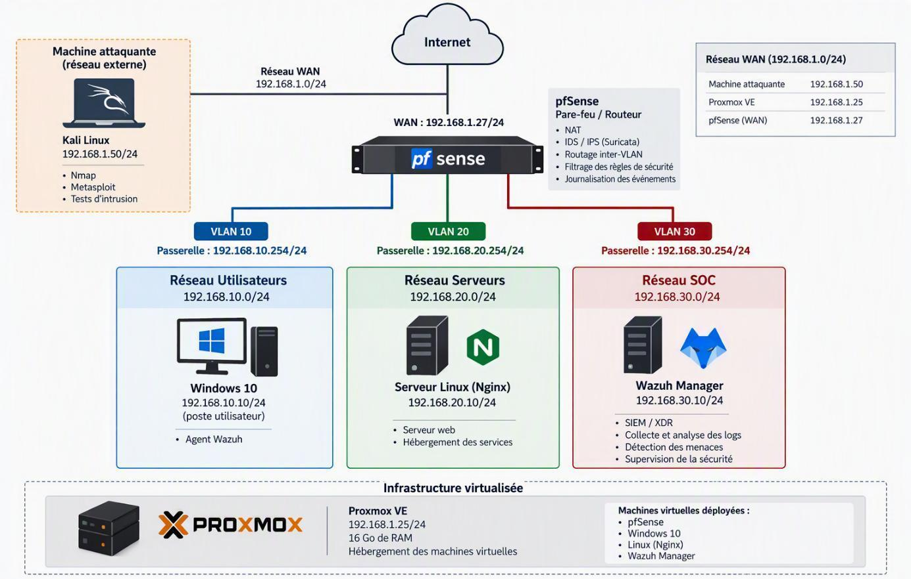

> *Note d'adressage : le schéma conceptuel ci-dessus illustre la structure logique des trois segments (`.10`), tandis que les machines effectivement provisionnées dans pfSense et Wazuh utilisent les IP `192.168.10.103` (LAN), `192.168.20.22` (DMZ) et `192.168.30.105` (SOC).*

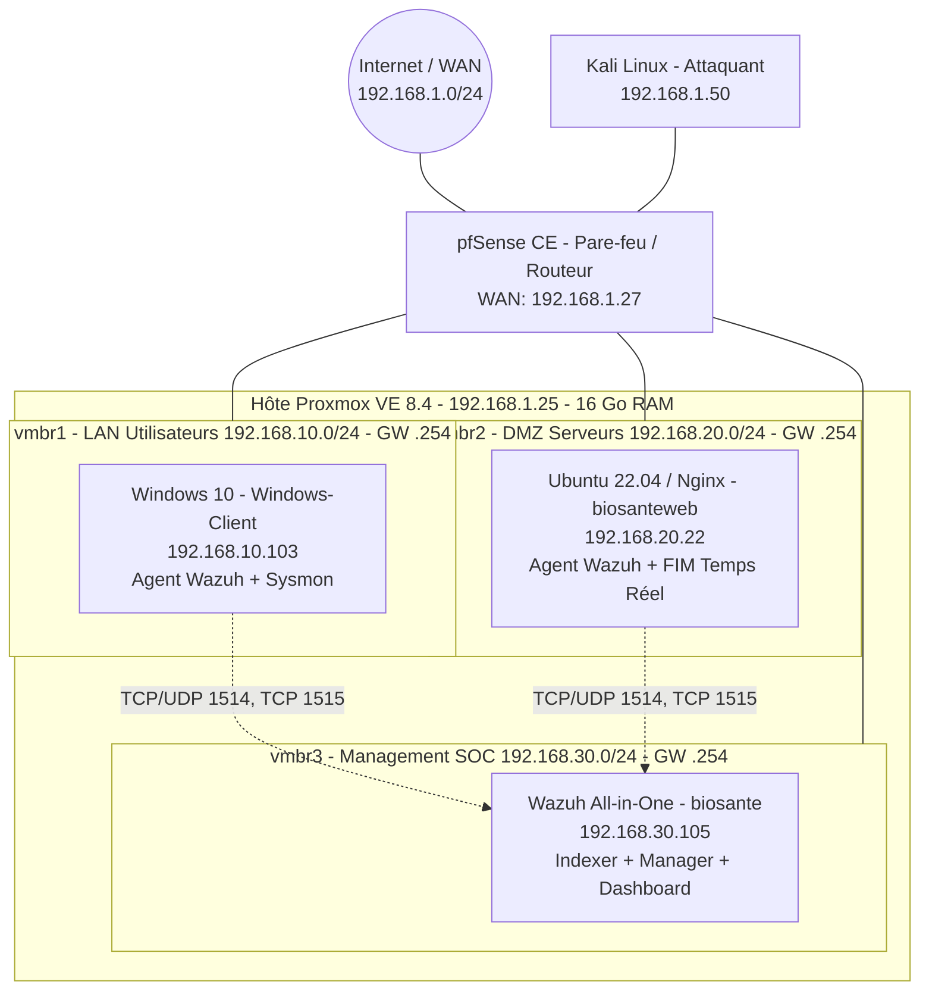

---

## 3. Déploiement étape par étape

### Étape 1 — Segmentation virtuelle sous Proxmox VE
Trois ponts Linux isolés sans interface physique associée assurent une séparation stricte de couche 2 (aucun flux inter-zones sans passage par pfSense) :
- `vmbr1` : LAN Utilisateurs (`192.168.10.0/24`)
- `vmbr2` : DMZ Serveurs (`192.168.20.0/24`)
- `vmbr3` : Management SOC (`192.168.30.0/24`)

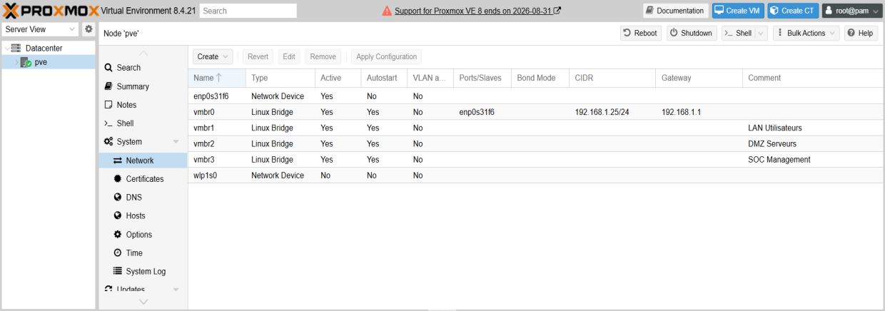

---

### Étape 2 — Filtrage pare-feu et Egress Filtering (pfSense)
Politique **Deny-by-Default** inspirée du Zero Trust (détail complet dans [`configs/pfsense/firewall-rules.md`](configs/pfsense/firewall-rules.md)) :
- **Isolation SOC** : Seuls les flux agents (`1514/TCP-UDP` collecte, `1515/TCP` enrôlement) et HTTPS (`443/TCP`) atteignent le serveur Wazuh (`192.168.30.105`).
- **Cloisonnement DMZ** : Blocage strict de tout flux initié depuis la DMZ vers le LAN.
- **Egress Filtering** : Sortie WAN limitée aux ports `53` (DNS), `80` (HTTP) et `443` (HTTPS).

**Règles zone SOC (`opt2`) :**

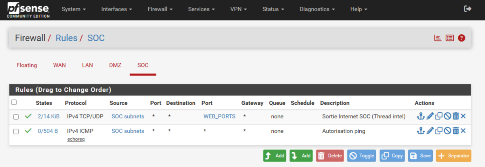

**Règles zone DMZ (`opt1`) :**

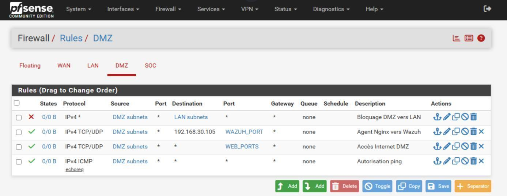

**Règles zone LAN & Egress Filtering :**

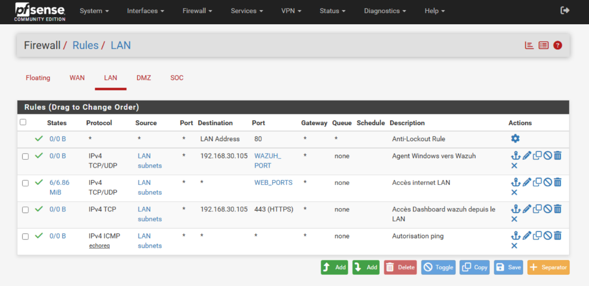

---

### Étape 3 — Déploiement & Tuning JVM de Wazuh All-in-One
Dans un environnement contraint à 8 Go de RAM pour la VM SOC, le dimensionnement du tas mémoire Java de l'indexeur OpenSearch est indispensable pour éviter tout déclenchement de l'**OOM Killer** du noyau Linux.

Paramétrage appliqué dans `/etc/wazuh-indexer/jvm.options` (voir [`configs/wazuh/jvm.options`](configs/wazuh/jvm.options)) :

```ini
-Xms4g
-Xmx4g
```

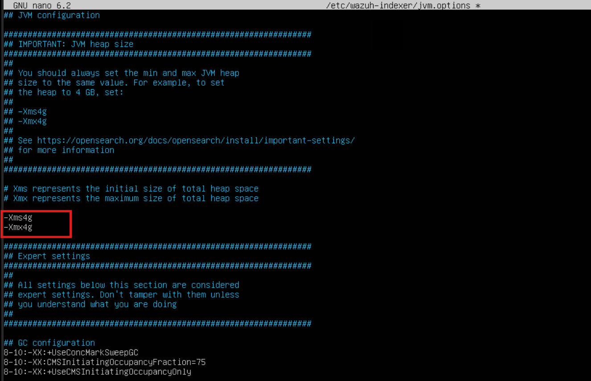

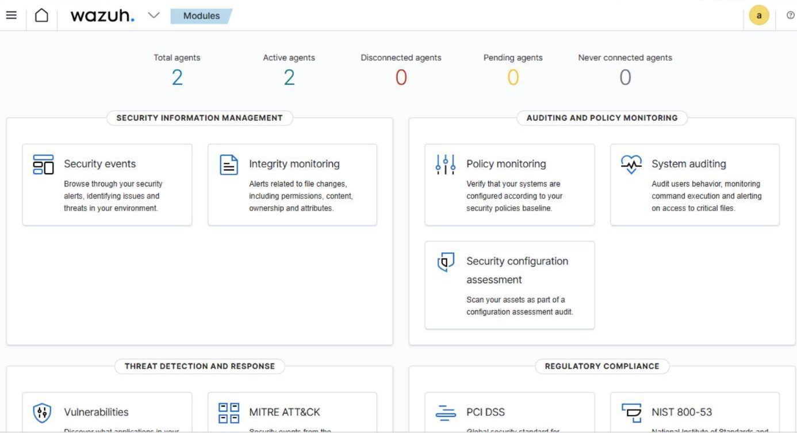

---

### Étape 4 — Enrôlement des agents, FIM, SCA et Vulnerability Detector
Déploiement reproductible via les scripts fournis dans le dépôt :
- **Serveur Ubuntu DMZ (`biosanteweb`)** : [`scripts/deploy-agent-ubuntu.sh`](scripts/deploy-agent-ubuntu.sh) + surveillance **FIM temps réel** (`inotify`) sur `/var/www/html` ([`configs/wazuh/agent-ubuntu-ossec-snippet.xml`](configs/wazuh/agent-ubuntu-ossec-snippet.xml)).
- **Poste Windows 10 LAN (`Windows-Client`)** : [`scripts/deploy-agent-windows.ps1`](scripts/deploy-agent-windows.ps1) + collecte **Sysmon** (Event ID 1) et **PowerShell Operational** (Event ID 4104) ([`configs/wazuh/agent-windows-ossec-snippet.xml`](configs/wazuh/agent-windows-ossec-snippet.xml)).
- **Audit de posture (SCA — CIS Benchmarks)** : Scores initiaux avant durcissement relevés à **41 %** sur `biosanteweb` et **29 %** sur `Windows-Client`.
- **Vulnerability Detector** : Détection passive des CVE par croisement d'inventaire logiciel, sans scan réseau intrusif (adapté aux environnements sensibles type IoMT).

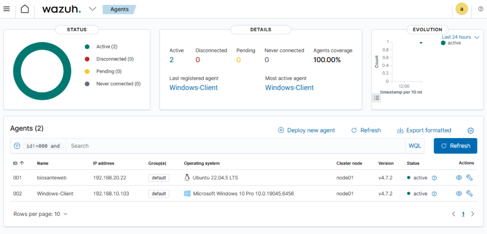

---

## 4. Simulations d'attaques & Validation MITRE ATT&CK

### Scénario 1 — Attaque par force brute SSH (`T1110`) + Active Response
- **Simulation (depuis Kali `192.168.1.50`)** : Ouverture temporaire du port TCP 22 vers la DMZ, puis attaque dictionnaire :
  ```bash
  hydra -l root -P /usr/share/wordlists/rockyou.txt ssh://192.168.20.22
  ```
- **Détection** : Corrélation temporelle des échecs dans `/var/log/auth.log` — alertes niveau 10 (`40111`, `2502`, règle de corrélation `5763` : 8 échecs en moins de 2 min).
- **Réponse automatisée** : Exécution locale de `firewall-drop` (`iptables`) via [`configs/wazuh/manager-active-response.xml`](configs/wazuh/manager-active-response.xml) bloquant l'IP attaquante pendant **180 secondes**.

```xml
<active-response>
  <command>firewall-drop</command>
  <location>local</location>
  <rules_id>5712,5763</rules_id>
  <timeout>180</timeout>
</active-response>
```

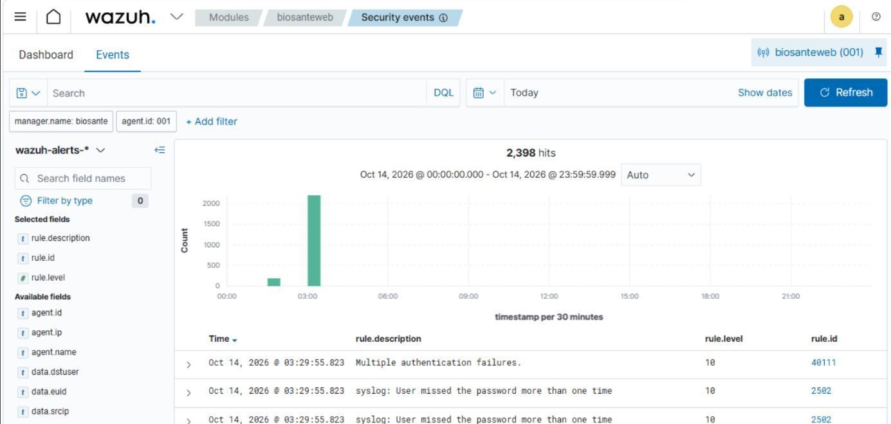

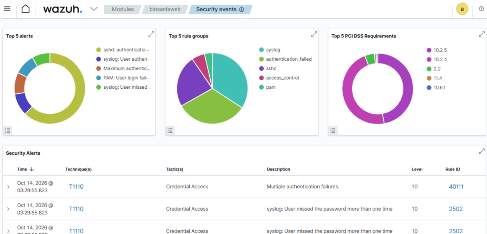

---

### Scénario 2 — Dépôt de Webshell & Compromission d'intégrité (`T1505.003`)
- **Simulation (sur `biosanteweb`)** : Dépôt d'un script PHP malveillant dans la racine web :
  ```bash
  echo "<?php system(\$_GET['cmd']); ?>" >> /var/www/html/shell.php
  ```
- **Détection** : Interception temps réel via `inotify` (`realtime="yes"`, `report_changes="yes"`). La règle native `554` (*File added*, niveau 5) étant trop basse pour un serveur exposé, une **règle personnalisée ID `100100` (niveau 12)** a été rédigée dans [`configs/wazuh/local_rules.xml`](configs/wazuh/local_rules.xml) :

```xml
<group name="local,syscheck,webshell,">
  <rule id="100100" level="12">
    <if_sid>554</if_sid>
    <field name="file" type="pcre2">(?i)^/var/www/html/.+\.(php|phtml|php5)$</field>
    <description>Possible webshell : fichier de script ajouté dans la racine web ($(file))</description>
    <mitre>
      <id>T1505.003</id>
    </mitre>
  </rule>
</group>
```

- **Piste d'amélioration identifiée** : Activer `whodata="yes"` (basé sur `auditd`) pour attribuer l'action à l'utilisateur et au processus exacts.

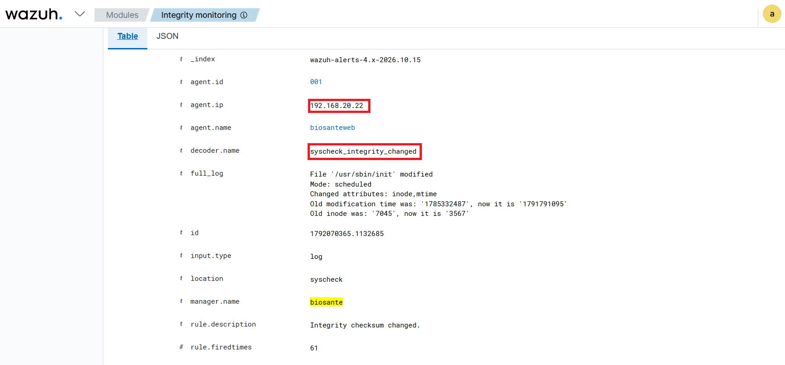

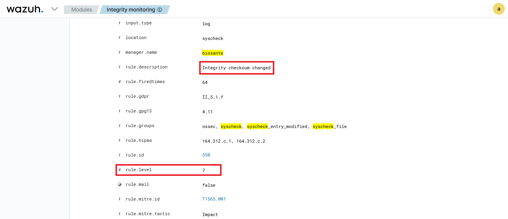

---

### Scénario 3 — Exécution PowerShell malveillante sur le LAN (`T1059.001`)
- **Simulation (sur `Windows-Client`)** : Exécution d'une commande PowerShell obfusquée simulant un payload issu d'un phishing :
  ```powershell
  powershell.exe -ExecutionPolicy Bypass -WindowStyle Hidden -EncodedCommand <payload_base64>
  ```
- **Détection** : Collecte enrichie via **Sysmon (Event ID 1)** et **PowerShell ScriptBlockLogging (Event ID 4104)**. Wazuh remonte l'arborescence parent/enfant, la ligne de commande complète, l'empreinte SHA-256 et la cartographie `T1059.001` (règle `92066`, preuve JSON complète dans [`evidence/sysmon-t1059-001-alert.json`](evidence/sysmon-t1059-001-alert.json)).

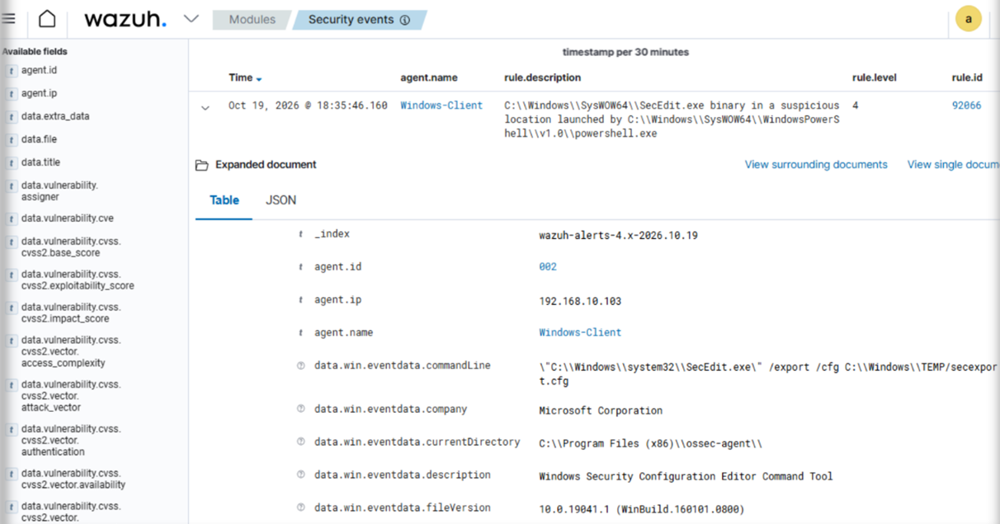

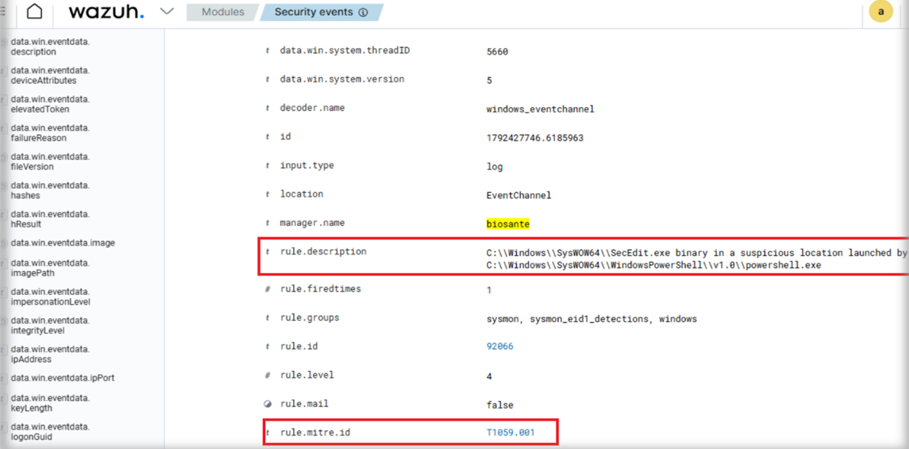

<details>
<summary>📄 Voir l'extrait JSON brut de l'alerte Sysmon Event ID 1 (règle 92066)</summary>

```json
{
  "agent": { "id": "002", "name": "Windows-Client", "ip": "192.168.10.103" },
  "manager": { "name": "biosante" },
  "rule": {
    "id": "92066",
    "level": 4,
    "description": "C:\Windows\SysWOW64\SecEdit.exe binary in a suspicious location launched by C:\Windows\SysWOW64\WindowsPowerShell\v1.0\powershell.exe",
    "groups": ["sysmon", "sysmon_eid1_detections", "windows"],
    "mitre": { "id": ["T1059.001"], "technique": ["PowerShell"] }
  },
  "data": {
    "win": {
      "system": {
        "eventID": "1",
        "channel": "Microsoft-Windows-Sysmon/Operational",
        "computer": "DESKTOP-89S4SBE",
        "systemTime": "2026-10-19T16:35:44.6432870Z"
      },
      "eventdata": {
        "image": "C:\Windows\SysWOW64\SecEdit.exe",
        "parentImage": "C:\Windows\SysWOW64\WindowsPowerShell\v1.0\powershell.exe",
        "hashes": "SHA256=56CB815F0FDA92C4658296692E4F70DEE557137528482FE7A834296BFDB710C0"
      }
    }
  }
}
```

</details>

---

### Synthèse des résultats

| Scénario | MITRE ATT&CK | Source de logs | Mécanisme Wazuh | Résultat | Limite identifiée |
| :--- | :--- | :--- | :--- | :---: | :--- |
| **1. Force brute SSH** | `T1110` *(Credential Access)* | `/var/log/auth.log` | Corrélation (niv. 10) + `firewall-drop` (180 s) | ✅ Détecté & bloqué | Attaques lentes/distribuées sous le seuil |
| **2. Webshell PHP** | `T1505.003` *(Persistence)* | `/var/www/html` | FIM temps réel (`554` → custom `100100` niv. 12) | ✅ Détecté | Attribution processus requiert `whodata` (`auditd`) |
| **3. PowerShell** | `T1059.001` *(Execution)* | Sysmon EID 1 / PS 4104 | `eventchannel` + règles Sysmon/PowerShell | ✅ Détecté | Aveugle sans journalisation Windows enrichie |

---

## 5. Stockage, Conformité RGPD & Analyse TCO (3 ans)

- **Rétention disque (SSD 256 Go)** : Avec 100 Go dédiés à l'indexeur et un seuil d'alerte OpenSearch (*low watermark*) à 85 % (85 Go utiles, lecture seule à 95 %), la rétention chaude atteint **~42 jours à 2 Go/jour**. Politique ISM + export d'archives froides recommandés.
- **TCO indicatif sur 3 ans** : **27 197,10 €** (dont **0 € de licence**, 347,10 € de matériel/énergie, et **98,7 % en temps humain** d'intégration, tuning et exploitation) — contre **25 350 € + 9 417 USD** sur Microsoft Sentinel à volume équivalent (`2 Go/jour`).
- **Conformité RGPD** : Cartographie intégrée des alertes (articles 32 et 33, plus HIPAA et PCI-DSS).
- **Documents détaillés du dépôt** :
  - 📈 Analyse stockage & TCO 3 ans : [`docs/tco-and-retention.md`](docs/tco-and-retention.md)
  - 🔒 Checklist de durcissement SOC avant production : [`docs/hardening-checklist.md`](docs/hardening-checklist.md)

---

## 6. Structure du dépôt & Durcissement

```text
biosante-soc-wazuh-homelab/
├── README.md
├── LICENSE
├── .gitignore
├── assets/images/                     # 14 captures d'écran recadrées (Proxmox, pfSense, Wazuh)
├── configs/
│   ├── pfsense/firewall-rules.md
│   └── wazuh/
│       ├── jvm.options
│       ├── local_rules.xml
│       ├── manager-active-response.xml
│       ├── agent-ubuntu-ossec-snippet.xml
│       └── agent-windows-ossec-snippet.xml
├── scripts/
│   ├── deploy-agent-ubuntu.sh
│   └── deploy-agent-windows.ps1
├── evidence/
│   └── sysmon-t1059-001-alert.json
└── docs/
    ├── hardening-checklist.md
    └── tco-and-retention.md
```

### Prolongements envisagés
- Émulation reproductible avec **Atomic Red Team** : `T1078` (Valid Accounts), `T1003.001` (LSASS Memory), `T1021.001` (RDP Lateral Movement), `T1486` (Ransomware encryption + isolement réseau automatique).
- Ajout d'une sonde réseau **Suricata (NDR)** sur port miroir pour couvrir les automates médicaux IoMT sans agent.
- Mesure horodatée systématique (synchronisée NTP) des délais `T0 → T1 → T2` (MTTD/MTTR technique) et campagne d'observation du bruit sur plusieurs semaines.

---

## 👤 Auteur & Licence

**Sylva Carlos Joyce AHYEE** — Mastère Expert Cybersécurité (HETIC)  
Distribué sous licence **MIT** (voir [`LICENSE`](LICENSE)). Ce dépôt est conçu à des fins éducatives et défensives (Blue Team / SOC Engineering).
